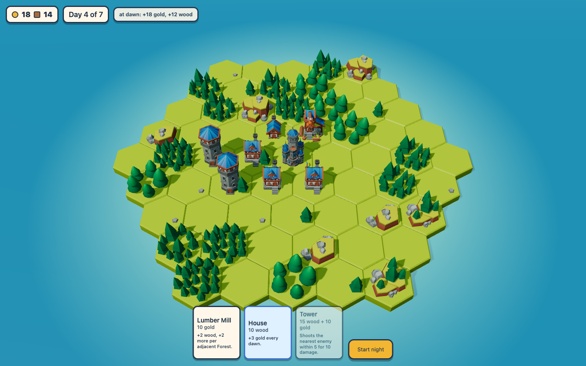
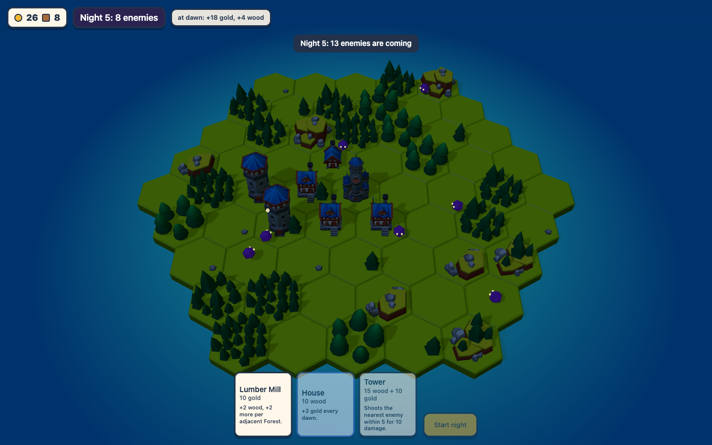
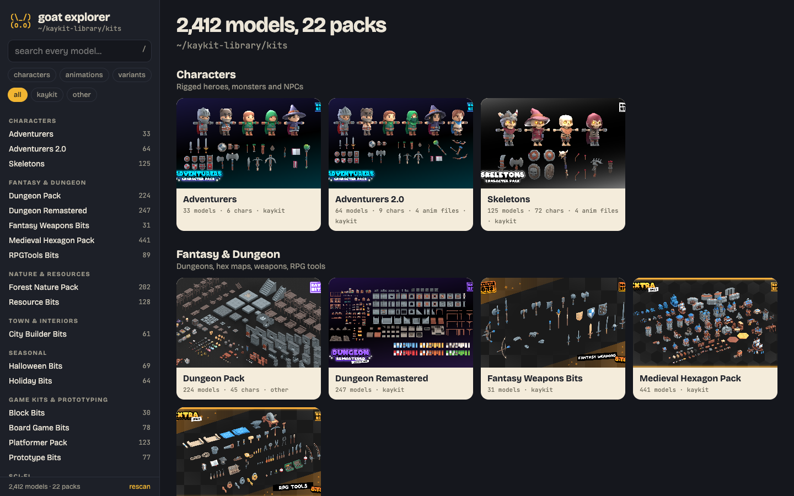
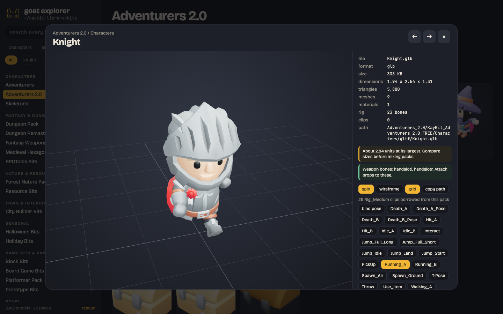
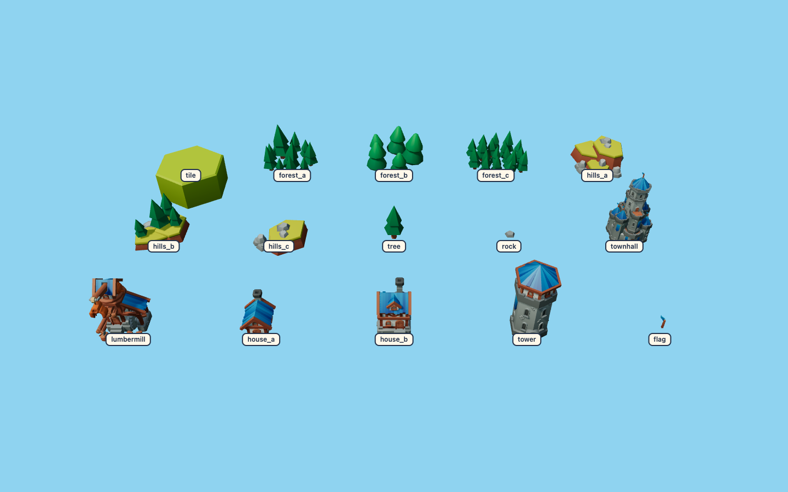
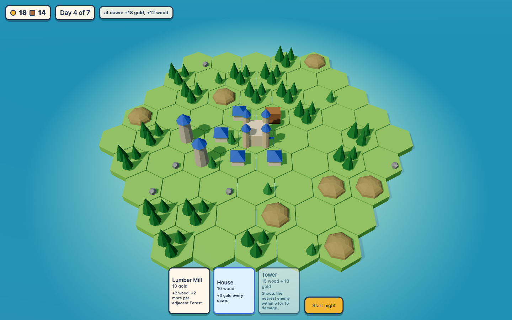

```
               (\_/)
               (o.o)    "one more night."
              /(___)--|=====>
         ______/_|_\______
        /  ^^    []    ^  \
   ~~  /  ^^^   [][]   |>  \  ~~
  ~~~  \   ^     []    ^^  /  ~~~
        \_________________/
           ~~    ~~~    ~~
```

# goat-game-creator

**Turn Claude Code into a game studio.** A Claude Code plugin plus a tiny zero-dependency toolkit that builds polished browser 3D games from free asset packs (KayKit, Kenney, Quaternius, all CC0) and checks its own work by playing the game and looking at screenshots.

[Türkçe](README.tr.md)

<p>
  
  
</p>

Think of [REA](https://github.com/morluto/rea) (Reverse Engineer Anything), but for games: the tools make the hard part possible, the method makes Claude do it properly. Here the hard part is not writing three.js. It is everything around it: picking assets that fit together, keeping the numbers in one place, testing balance with a bot instead of vibes, and never calling a change done before seeing it on screen.

## Install

```bash
# inside Claude Code
/plugin marketplace add goatstarter/goat-game-creator
/plugin install goat-game-creator@goat-game-creator
```

Then:

```
/make-game    English
/oyun-yap     Türkçe
```

> /make-game a cozy island tower defence: build by day, skeletons attack at night. My assets are in ~/game-assets.

The toolkit runs straight from GitHub, no install:

```bash
npx -y github:goatstarter/goat-game-creator doctor --assets ~/game-assets
npx -y github:goatstarter/goat-game-creator explore ~/game-assets
npx -y github:goatstarter/goat-game-creator new my-game --assets ~/game-assets
npx -y github:goatstarter/goat-game-creator shot "http://localhost:5151/?sim=3" shots/day4.png
```

## The method

The skill walks Claude through the same loop every time:

1. **Pick assets** in the explorer and check they fit one style (no voxel next to smooth low-poly).
2. **Scaffold** from the starter: zero-dep node server, three.js from an import map, assets served at `/files/`.
3. **Design the core loop** on one page (day/night, build/defend) and get your yes.
4. **Build v1 ugly but playable first**: a pure `sim.js` with a fixed `step(dt)`, every number in `rules.js`, a bot that plays it, debug hooks (`?sim`, `?gallery`, `?autoplay`).
5. **Verify every change**: tests and a bot in node, a headless screenshot, and actually look at it.
6. **Iterate in rounds you steer** ("make the water nicer", "enemies too strong"), numbers stay in `rules.js`, balance comes from bot runs.
7. **Polish pass**: lighting, post-fx, water, juice, UI, audio.
8. **Promise tests**: every tooltip and card text is checked against the real rules.

The plan is ugly v1, playable v2, polished v3. [`skills/make-game/references/prompts.md`](skills/make-game/references/prompts.md) has the prompt sequence for each step.

## What is inside

| | |
|---|---|
| `skills/make-game`, `skills/oyun-yap` | The method (EN / TR) with references: asset gotchas, verify loop, design loop, polish checklist, prompts |
| `explorer/` | Asset explorer for any folder: live 3D previews, packs, search, colour variants, animation clips, size and rig diagnostics |
| `starter/` | A small but real hex game to grow from: build by day, defend by night, sim + bot + tests + debug hooks + screenshot script |
| `bin/goat-game.js` | `new`, `explore`, `shot`, `doctor` |

### The explorer

`goat-game explore <dir>` works on any folder of glb, gltf, obj or fbx files. Folders become packs, FREE/EXTRA editions merge, the same model in four formats shows once, and `_red` / `_blue` / `_Color1` collapse into one card with variant buttons. KayKit folders get themed sections and characters borrow their rig's animation clips. The viewer tells you what bites later: size in units, triangle count, bones and weapon hand slots, FBX in centimeters, missing textures. It only reads your folder. Thumbnails are cached in your temp folder.

<p>
  
  
</p>

### The starter

`goat-game new my-game --assets ~/game-assets` copies a playable hex island game: draw your island from a seed, build Lumber Mills, Houses and Towers by day, survive 7 nights of enemies walking in from the shore. It uses KayKit Medieval Hexagon (free edition) when it finds it anywhere in your asset folder, and falls back to coloured shapes when it does not, so it always runs.

| URL | What it does |
|---|---|
| `?seed=7` | same island, same run |
| `?sim=3` | the bot plays 3 days and nights instantly, one state line goes to `#debuglog` |
| `?night=6` | start the night and pre-run 6 sim seconds (combat screenshots) |
| `?autoplay&speed=4` | the bot plays on screen |
| `?gallery` | every model in a labelled grid, plus a found/missing report |
| `?noassets` | force the coloured-shape fallback |
| `?r.START.gold=200` | override any number in `rules.js` |

`npm test` runs the sim rules, promise tests and a balance report (the bot wins about 80% of 40 seeds).

<p>
  
  
</p>

## Where to get free assets

Assets are **not included** in this repo. Download them from their creators and unzip everything into one folder (for example `~/game-assets`):

| Pack | Where | License |
|---|---|---|
| **KayKit** by Kay Lousberg | [kaylousberg.itch.io](https://kaylousberg.itch.io) / [kaylousberg.com](https://kaylousberg.com) | CC0 (free editions, plus paid EXTRA editions) |
| **Kenney** | [kenney.nl](https://kenney.nl) | CC0 |
| **Quaternius** | [quaternius.com](https://quaternius.com) | CC0 |

The starter is tuned for **KayKit Medieval Hexagon Pack**. CC0 means you can use them in anything, but crediting the artists is the right thing to do, and they all accept tips.

## Built with this method

**Hex Kingdom**, an island-building tower defence on KayKit Medieval Hexagon: draw land cards by day, build with adjacency bonuses, hold your Town Hall against skeleton waves by night, bosses on nights 6, 9 and 12, blessings at dawn, reflective ocean with a shoreline that follows the coast, post-processing, villagers, a greedy balance bot and promise tests for every card. It was built with Claude round by round using exactly this loop. The starter here is a deliberately small slice of it.

## Honest note

Claude still needs steering. This is a method and a toolkit, not a one-click game generator. You decide what is fun and what looks right; Claude builds, tests, screenshots and tells you what it saw. Expect many short rounds, not one big prompt.

## Requirements

- Node.js 18 or newer. No npm dependencies.
- For screenshots: Google Chrome, Chromium, Edge or Brave (or `CHROME_PATH`), or Python Playwright.
- Internet on first load: three.js comes from the jsDelivr CDN.

## Develop

```bash
npm test     # starter sim + promise tests, CLI and server smoke tests
```

## License

MIT for the code. Asset packs belong to their creators under their own licenses. Made by [Goatstarter](https://goatstarter.com).
