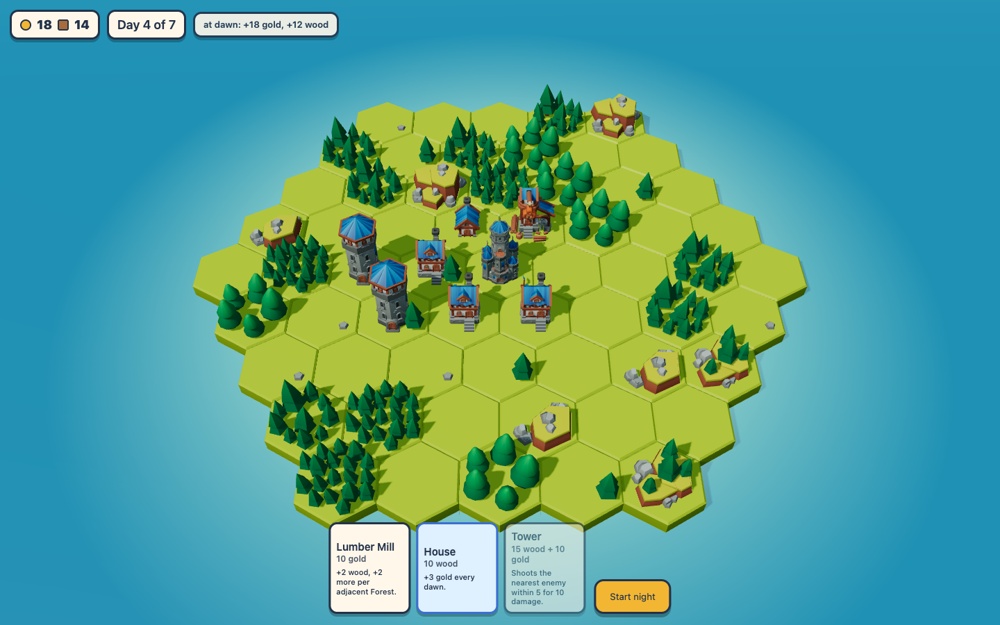
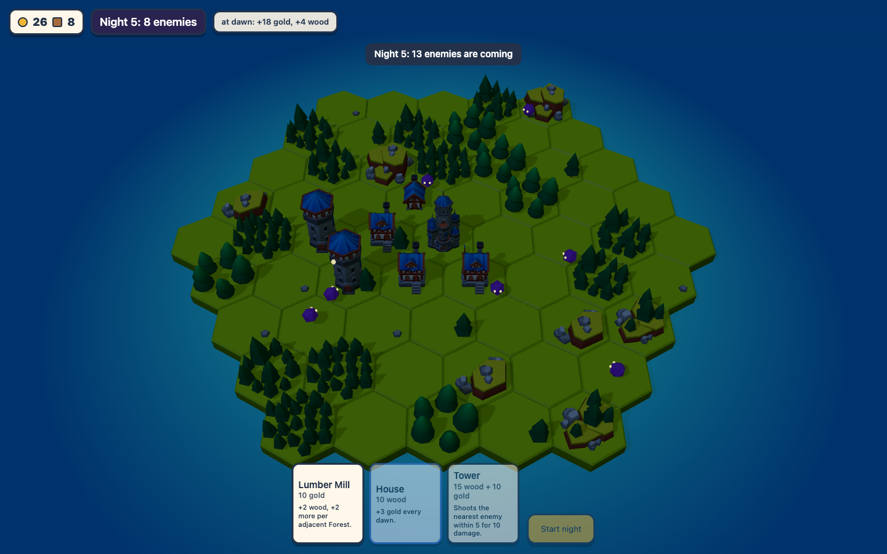
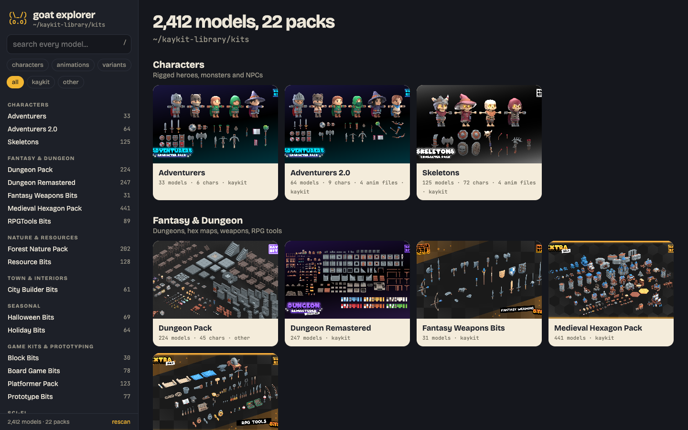
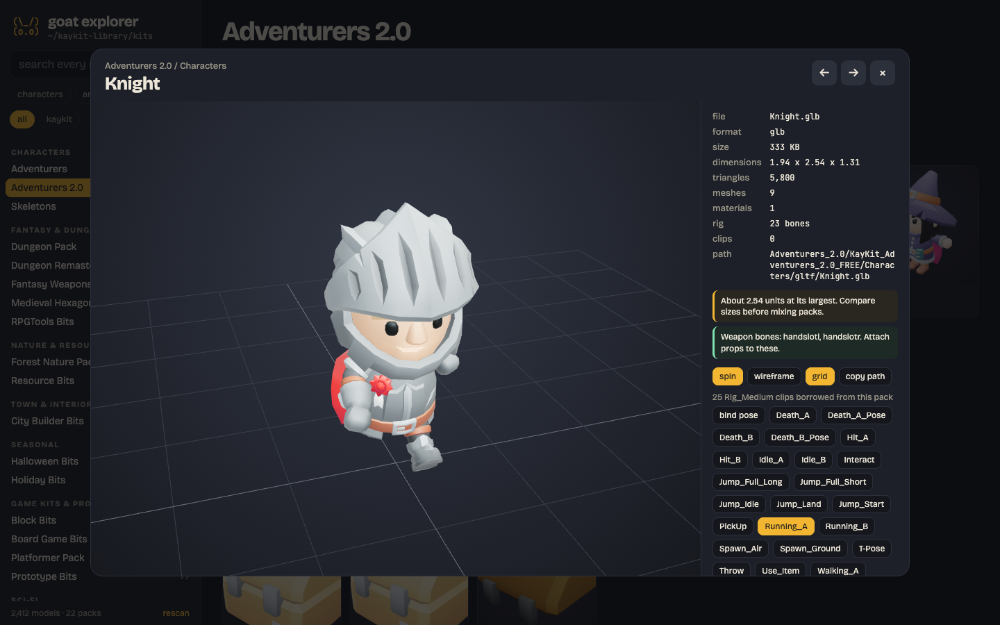
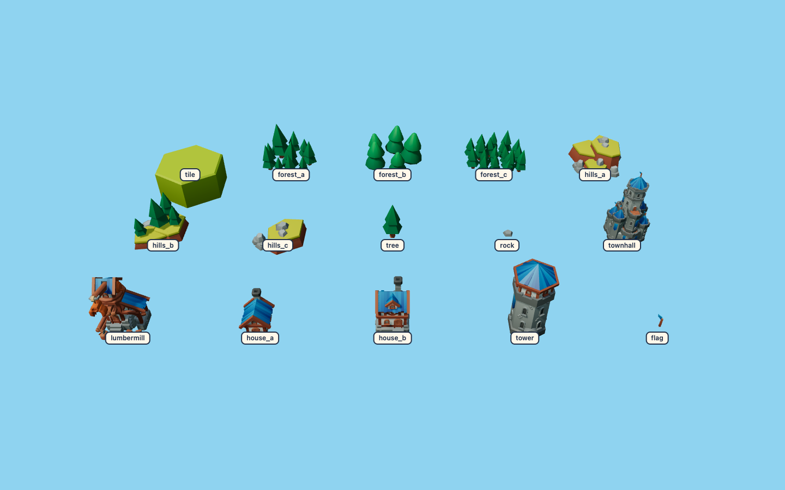
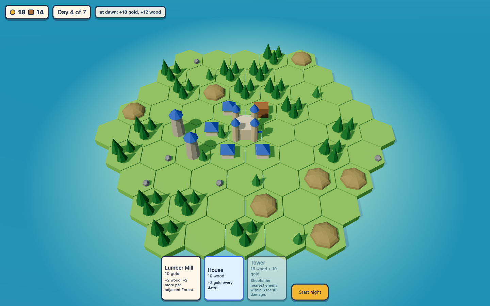

```
               (\_/)
               (o.o)    "bir gece daha."
              /(___)--|=====>
         ______/_|_\______
        /  ^^    []    ^  \
   ~~  /  ^^^   [][]   |>  \  ~~
  ~~~  \   ^     []    ^^  /  ~~~
        \_________________/
           ~~    ~~~    ~~
```

# goat-game-creator

**Claude Code'u bir oyun stüdyosuna çevir.** Ücretsiz asset paketlerinden (KayKit, Kenney, Quaternius, hepsi CC0) cilalı tarayıcı 3D oyunları kuran, işini oyunu oynayıp ekran görüntülerine bakarak kendisi kontrol eden bir Claude Code eklentisi ve bağımlılıksız küçük bir araç seti.

[English](README.md)

<p>
  
  
</p>

[REA](https://github.com/morluto/rea)'yı (Reverse Engineer Anything) düşün, ama oyunlar için: araçlar zor kısmı mümkün kılar, yöntem Claude'un onu düzgün yapmasını sağlar. Burada zor kısım three.js yazmak değil. Etrafındaki her şey: birbirine uyan asset'leri seçmek, sayıları tek bir yerde tutmak, dengeyi hisle değil botla test etmek ve ekranda görmeden hiçbir değişikliğe "bitti" dememek.

## Kurulum

```bash
# Claude Code içinde
/plugin marketplace add goatstarter/goat-game-creator
/plugin install goat-game-creator@goat-game-creator
```

Sonra:

```
/oyun-yap     Türkçe
/make-game    English
```

> /oyun-yap rahat bir ada kule savunması: gündüz inşa, gece iskeletler saldırıyor. Asset'lerim ~/game-assets içinde.

Araç seti kurulum gerektirmeden doğrudan GitHub'dan çalışır:

```bash
npx -y github:goatstarter/goat-game-creator doctor --assets ~/game-assets
npx -y github:goatstarter/goat-game-creator explore ~/game-assets
npx -y github:goatstarter/goat-game-creator new oyunum --assets ~/game-assets
npx -y github:goatstarter/goat-game-creator shot "http://localhost:5151/?sim=3" shots/gun4.png
```

## Yöntem

Skill, Claude'u her seferinde aynı döngüden geçirir:

1. **Asset seç**: gezginde gez, hepsinin tek bir stile uyduğunu kontrol et (yumuşak low-poly'nin yanında voxel olmaz).
2. **Şablondan kur**: bağımlılıksız node sunucusu, import map ile three.js, `/files/` altından sunulan asset'ler.
3. **Çekirdek döngüyü tasarla**: tek sayfada (gündüz/gece, inşa/savunma), senin onayınla.
4. **Önce çirkin ama oynanabilir v1**: sabit `step(dt)` ile saf bir `sim.js`, her sayı `rules.js`'te, oyunu oynayan bir bot, debug kancaları (`?sim`, `?gallery`, `?autoplay`).
5. **Her değişikliği doğrula**: node'da testler ve bot, headless ekran görüntüsü ve ona gerçekten bakmak.
6. **Senin yönettiğin turlar**: "suyu daha güzel yap", "düşmanlar çok güçlü". Sayılar `rules.js`'te kalır, denge bot koşularından gelir.
7. **Cila turu**: ışık, post-fx, su, juice, arayüz, ses.
8. **Söz testleri**: her ipucu ve kart metni gerçek kurallara karşı test edilir.

Plan şu: çirkin v1, oynanabilir v2, cilalı v3. Her adımın prompt sırası [`skills/oyun-yap/references/promptlar.md`](skills/oyun-yap/references/promptlar.md) dosyasında.

## İçinde ne var

| | |
|---|---|
| `skills/oyun-yap`, `skills/make-game` | Yöntem (TR / EN) ve referansları: asset tuzakları, doğrulama döngüsü, tasarım döngüsü, cila listesi, promptlar |
| `explorer/` | Herhangi bir klasör için asset gezgini: canlı 3D önizleme, paketler, arama, renk varyantları, animasyon klipleri, boyut ve rig teşhisi |
| `starter/` | Büyütmek için küçük ama gerçek bir hex oyunu: gündüz inşa, gece savunma, sim + bot + testler + debug kancaları + ekran görüntüsü betiği |
| `bin/goat-game.js` | `new`, `explore`, `shot`, `doctor` |

### Gezgin

`goat-game explore <klasör>` içinde glb, gltf, obj ya da fbx olan her klasörde çalışır. Klasörler pakete dönüşür, FREE/EXTRA sürümleri birleşir, dört formatta gelen aynı model tek kez görünür, `_red` / `_blue` / `_Color1` varyant düğmeli tek bir karta toplanır. KayKit klasörleri temalı bölümlere ayrılır ve karakterler kendi rig'lerinin animasyon kliplerini ödünç alır. Görüntüleyici sonradan başını ağrıtacak şeyleri söyler: birim cinsinden boyut, üçgen sayısı, kemikler ve silah el yuvaları, santimetre cinsinden FBX'ler, eksik dokular. Klasörüne sadece okumak için dokunur. Küçük resimler geçici klasörde önbelleklenir.

<p>
  
  
</p>

### Başlangıç oyunu

`goat-game new oyunum --assets ~/game-assets` oynanabilir bir hex ada oyunu kopyalar: adan bir seed'den çıkar, gündüz Kereste Atölyesi, Ev ve Kule inşa et, kıyıdan yürüyerek gelen düşmanlara karşı 7 gece dayan. Asset klasöründe herhangi bir yerde bulursa KayKit Medieval Hexagon'u (ücretsiz sürüm) kullanır, bulamazsa renkli şekillere geçer, yani her zaman çalışır.

| URL | Ne yapar |
|---|---|
| `?seed=7` | aynı ada, aynı oyun |
| `?sim=3` | bot 3 gündüz ve geceyi anında oynar, tek satırlık durum `#debuglog` içine yazılır |
| `?night=6` | geceyi başlatır ve sim'i 6 saniye ileri sarar (savaş ekran görüntüleri için) |
| `?autoplay&speed=4` | bot ekranda oynar |
| `?gallery` | her model etiketli bir ızgarada, bulundu/eksik raporuyla |
| `?noassets` | renkli şekillere zorlar |
| `?r.START.gold=200` | `rules.js`'teki herhangi bir sayıyı değiştirir |

`npm test` sim kurallarını, söz testlerini ve bir denge raporunu çalıştırır (bot 40 seed'in yaklaşık %80'ini kazanır).

<p>
  
  
</p>

## Ücretsiz asset'ler nereden bulunur

Asset'ler bu repoya **dahil değildir**. Onları yapanlardan indir ve hepsini tek bir klasöre aç (örneğin `~/game-assets`):

| Paket | Nerede | Lisans |
|---|---|---|
| **KayKit**, Kay Lousberg | [kaylousberg.itch.io](https://kaylousberg.itch.io) / [kaylousberg.com](https://kaylousberg.com) | CC0 (ücretsiz sürümler, ayrıca ücretli EXTRA sürümler) |
| **Kenney** | [kenney.nl](https://kenney.nl) | CC0 |
| **Quaternius** | [quaternius.com](https://quaternius.com) | CC0 |

Başlangıç oyunu **KayKit Medieval Hexagon Pack** için ayarlandı. CC0, bu paketleri her yerde kullanabileceğin anlamına gelir; yine de sanatçılara teşekkür etmek doğrusu, hepsi bağış da kabul ediyor.

## Bu yöntemle yapıldı

**Hex Kingdom**, KayKit Medieval Hexagon üzerinde ada kurmalı bir kule savunması: gündüz arazi kartları çek, komşuluk bonuslarıyla inşa et, gece iskelet dalgalarına karşı Belediye Binası'nı koru, 6., 9. ve 12. gecelerde boss, şafakta lütuf seçimi, kıyı şeridini takip eden yansımalı bir okyanus, post-processing, köylüler, açgözlü bir denge botu ve her kart için söz testleri. Claude ile tur tur, tam olarak bu döngüyle yapıldı. Buradaki başlangıç oyunu onun bilerek küçük tutulmuş bir parçası.

## Dürüst not

Claude'un hâlâ yönlendirilmesi gerekir. Bu tek tıkla oyun üreten bir araç değil, bir yöntem ve araç seti. Neyin eğlenceli olduğuna ve neyin doğru göründüğüne sen karar verirsin; Claude kurar, test eder, ekran görüntüsü alır ve ne gördüğünü söyler. Tek büyük prompt değil, çok sayıda kısa tur bekle.

## Gereksinimler

- Node.js 18 ya da üstü. npm bağımlılığı yok.
- Ekran görüntüsü için: Google Chrome, Chromium, Edge ya da Brave (veya `CHROME_PATH`), ya da Python Playwright.
- İlk yüklemede internet: three.js, jsDelivr CDN'inden gelir.

## Geliştirme

```bash
npm test     # başlangıç oyununun sim ve söz testleri, CLI ve sunucu testleri
```

## Lisans

Kod MIT lisanslıdır. Asset paketleri kendi lisanslarıyla yapımcılarına aittir. [Goatstarter](https://goatstarter.com) tarafından yapıldı.
